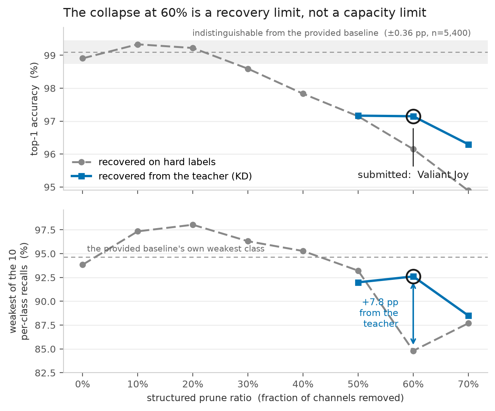

# Valiant Joy

**The Minimalist Edge AI Challenge — Software Optimization Track**
Submission: `valiant_joy_int8.onnx` — the provided MobileNetV2 with 60 % of its channels removed,
recovered against the provided ResNet-50 teacher, and quantized to static INT8 (QDQ).

> **The point where compression stops paying is set by how well you can recover, not by how hard
> you prune.** At 60 % the model collapses on hard labels and survives on the teacher's soft
> targets — same cut, same budget, same code. We found the stopping point by measuring the
> recovery, which is not where anyone looks.

| | baseline (provided) | Valiant Joy | ratio |
|---|---|---|---|
| Top-1 accuracy | 0.9909 | 0.9715 | **98.04 % retained** |
| Weakest of the 10 classes | 0.9466 | 0.9261 | −2.05 pp (see *What it costs*) |
| Parameters | 2,236,682 | 400,954 | **5.58×** |
| On-disk size | 8.77 MB (`.pt`) | 0.60 MB | **14.51×** · 14.07× ONNX-to-ONNX |
| MACs | 326.2 M | 79.5 M | **4.10×** |
| Latency — this laptop, 4 threads | 3.501 ms | 1.119 ms | 3.13× |
| **Latency — Qualcomm AI Hub, QCS6490** | **27.969 ms** | **3.127 ms** | **8.94×** |
| Peak RAM — laptop, raw process RSS | 78.85 MB | 62.14 MB | 1.27× |
| Peak memory — AI Hub | 32.33 MB | 19.45 MB | 1.66× |
| Energy per inference | 0.2177 J | 0.0709 J | **3.07×** |

## The cliff, and the statistic that can see it

We swept structured prune ratio from 0 to 70 % in steps of 10, exported every point and quantized
every point. Read the top panel of the figure as a mean and the first thing it says is false:
pruning 10 % of the channels *improved* accuracy, 0.9909 to 0.9944. On 5,400 validation images the
95 % interval on a difference between two variants is ±0.36 points, and everything from 0 % to 20 %
sits inside it. That flat stretch is the width of our measurement, not a plateau of preserved
accuracy.

The mean is no better at finding the other end. Between 50 % and 60 % it loses one point — unremarkable
next to the rest of the curve. Over the same step the weakest of the ten classes loses **eight and a
half**, from 0.9322 to 0.8480. That is the cliff section 6.1 asks about, and a team plotting only the
average cannot see it: at 60 % the average still reads 97.03 % retained, which is the band a
conservative submission sits in, sitting right next to the best compression on the curve.

Past the cliff the distribution stops behaving altogether. At 70 % the mean is worse than at 60 %
and the weakest class is *better*, 0.8770 against 0.8480 — which class collapses depends on where
the cuts happened to land, so an ordering by mean no longer implies an ordering by worst case.

## The cliff is a recovery limit

The obvious reading of that collapse is that 60 % removes capacity the task needs. It does not.
Everything above was recovered on hard labels for three epochs. Recovered instead against the
ResNet-50 the organisers provided — the soft-target route section 4 suggests — the same 60 % prune
comes back to 0.9715 accuracy and **0.9261 on the weakest class: seven and a half points the
hard-label run threw away.** Same cut, same architecture, same quantization.

What makes this a finding rather than a tuning win is that the benefit is not monotonic in the
damage. Going from hard labels to KD is worth **nothing** at 50 % (0.9322 → 0.9199, slightly worse),
**+7.5 points** at 60 %, and **+0.8 points** at 70 %. It peaks in a window: shallow enough that the
network still has the capacity to use a richer signal, deep enough that one correct label per image
is no longer enough to rebuild from. Below that window the hard-label recovery is already at its
ceiling and the teacher has nothing to add — this student was distilled from this exact teacher
before we received it. Above it, there is too little left to teach.

So the deepest defensible prune is not a property of the architecture. It is a property of the
recovery budget, and ours moved it by a full step of the ladder — 2.61× parameters to 5.58×, for a
change in how the fine-tuning loss is computed.

## The laptop understates the prize threefold

Everything above was measured on a development laptop, which is not the deployment target and does
not behave like one. Compiled to ONNX and profiled on the CPU of a Dragonwing RB3 Gen 2 Vision Kit
(QCS6490) — section 7 names no profile, so this is the documented substitute — the same two files
give **8.94× faster inference against the laptop's 3.13×**, and 1.66× lower peak memory against
1.27×. A large out-of-order core with a big cache absorbs the cost of a fat model and hides most of
what compression buys; the small core cannot. Anyone choosing a prune ratio by watching their own
laptop is reading a gradient about three times too shallow.

## What it costs, stated plainly

The weakest class is 0.9261, which is 2.05 points **below** the provided baseline's own weakest class
of 0.9466, and two of the ten classes sit under 0.95 where the baseline has one. The per-class
spread widens from 5.34 points to 7.39. We are not going to describe that as free.

We also measured the conservative alternative and it is a real submission: the 40 % prune retains
98.73 %, lifts the weakest class to 0.9528, and puts **no class below 0.95** — tighter than the model
we were handed. It gives up less than one point of mean accuracy relative to what we submit, and it
gives up 2.1× of parameter compression, 1.8× of file compression, and a third of the speed-up and
the energy saving. Four criteria are scored; that trade loses ground on three of them to protect
part of one, and 98.04 % retention is not a weak model by any reading of the first half of the
accuracy criterion. That is the judgement, and the 40 % model is in the repository under tag
`submission-v1` for anyone who wants to check the other side of it.

## Method, and what we threw away

Structured pruning (channels removed, not masked), BN recalibration, eight epochs of KD recovery
against the provided teacher (T = 4, α = 0.7), then static INT8 QDQ with per-channel weights and
percentile calibration chosen automatically by SQNR. Accuracy is top-1 over 5,400 held-out images
with the full confusion matrix kept; evaluation is `Resize(224) → ToTensor → Normalize`, no crop,
against the ONNX file. `val_split.json` is ours — the organisers confirmed each team generates it.

Discarded, with reasons:

- **Unstructured pruning.** Changes neither parameter count, file size nor latency. One run.
- **Dynamic INT8.** 12.6–16.8× *slower* than FP32 on convolutions at one thread in our own earlier
  measurements, and it emits operators AI Hub rejects.
- **Per-layer prune allocation.** Measured better than a uniform ratio at matched size — 0.9707
  against 0.9630 on the weakest class at the same parameter count — and it **cannot go deep**. Asked
  for 60 % of parameters it delivered 46.6 %, touching eleven of forty-nine layers: the damage
  budget runs out, because the parameters that are cheap to remove are a small bounded pool. Depth
  requires taking expensive ones, which is also why the weakest class is what breaks first.
- **Distilling a smaller architecture from the teacher.** Out of scope; the task is to compress the
  model we were given.
- **An energy measurement that disagreed with physics.** Under CodeCarbon's TDP fallback the packet
  says energy is latency times a constant, which is testable: divide each file's Joules by its own
  latency and the two must agree. A three-session run gave 53.1 W and 72.3 W and was thrown out.
  Seven sessions, median kept, impossible readings dropped: 62.2 W and 63.4 W, and a 3.07× energy
  ratio against a 3.13× latency ratio. `codecarbon_mode` is `tdp_estimate` — no RAPL on this
  machine — so the ratio is meaningful because the constant cancels, and the absolute Joules figure
  is not evidence about this model.

One cost we did not pay and a judge would: recovery ran on a GPU. The pipeline is unchanged on CPU,
but eight KD epochs will dominate the wall clock there.

## Conclusion

The cliff at 60 % is real, it is invisible in the mean, and it is not where the model runs out of
capacity — it is where hard-label recovery runs out of signal. Replacing that signal with the
teacher's moved the deepest usable prune a full step down the ladder and roughly doubled every
compression and efficiency figure we report.

Valiant Joy keeps 98.04 % of the baseline's accuracy while removing 82 % of its parameters, running
**8.94× faster on a constrained device**, using 3.07× less energy per inference, and fitting in a
0.60 MB file.
