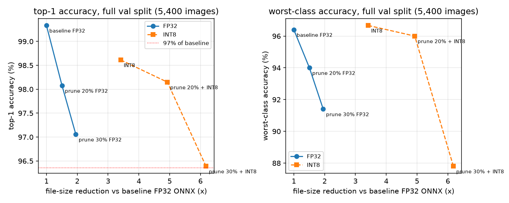

# EuroSAT MobileNetV2: structured pruning + static INT8 (SEC 2026, Software Track)

**Team:** Valiant Joy  **Model:** Valiant Joy  **Submission:** `student_model_int8.onnx` (input `(1, 3, 224, 224)`, ONNX opset 13, QDQ)

## Result

Starting point: the provided `student_mobilenetv2_distilled.pt`. Final model: 20% structured channel
pruning, 600-step recovery fine-tune, static INT8 (QDQ). All numbers below were measured on the same
machine with the same scripts and settings (`sec2026/measure.py`); the baseline is the provided
checkpoint exported to FP32 ONNX, because the submission is ONNX and Section 5.4 asks for identical
methods for baseline and final.

| | Baseline (FP32 ONNX) | Final (prune 20% + INT8) | Ratio |
|---|---|---|---|
| Top-1 accuracy (5,400 val images) | 99.33% | 98.15% | 98.8% retained |
| Worst-class accuracy | 96.40% (PermanentCrop) | 96.00% (PermanentCrop) | -0.40 pt |
| Parameters | 2.220 M | 1.470 M | 1.51x fewer |
| File size | 8.51 MiB | 1.73 MiB | 4.92x smaller |
| MACs | 0.300 G | 0.224 G | 1.34x fewer |
| Latency, local CPU (mean of 50 runs) | 6.49 ms | 5.98 ms | 1.09x faster |
| Peak RAM, raw process RSS | 82.3 MB | 71.1 MB | 1.16x lower |
| Energy, CodeCarbon (measured, `windows_emi`) | 0.1475 J | 0.1174 J | 1.26x lower |
| AI Hub, Dragonwing RB3 Gen 2 (ONNX Runtime, CPU) | 28.15 ms, 27.3 MB | 5.64 ms, 24.4 MB | 5.0x faster, 1.12x lower |

Measurement machine: MSI Bravo 15, AMD Ryzen 7 4800H (8 cores / 16 threads, AVX2, **no AVX-VNNI**),
16 GB RAM, CPU only, Windows 11 (build 26200), Python 3.11.9, PyTorch 2.14.0, ONNX Runtime 1.30.0.
Latency, peak RAM and energy are medians of 3 sessions, each in a fresh process, whole-machine CPU
load recorded before each session (4-16%).

## What we tried, kept and discarded

1. **Static INT8 of the unpruned student (kept as the safe fallback, `submission_v1`).** We compared
   four calibrations on 256 training images. MinMax lost 1.4 points and the worst class fell to 93.0%
   (output SQNR 15.6 dB). Percentile (99.999) calibration with `reduce_range` (7-bit weights, the
   ONNX Runtime recommendation for x86 CPUs without VNNI, which this one lacks) kept 98.61% and the
   worst class at 96.67%. Result: 3.42x smaller file, but **no latency gain on this laptop** (6.53 vs
   6.49 ms): without VNNI the INT8 kernels are no faster than FP32. On AI Hub's RB3 Gen 2 (Arm CPU)
   the same file runs **4.1x faster** than FP32 (6.83 vs 28.15 ms) and the pruned final model 5.0x faster (5.64 ms), so the gain is hardware-dependent;
   peak memory there rose 11% (30.2 vs 27.3 MB), which we report rather than hide.
2. **Structured pruning (kept at 20%).** Channels are removed (torch-pruning dependency graph, so
   residual and depthwise layers stay consistent); the exported ONNX parameter count really drops
   (unstructured pruning would only zero weights). Every layer group loses the same fraction,
   rounded to multiples of 8 channels, with the classifier protected. BatchNorm statistics are
   re-estimated on training images, then a short recovery fine-tune (SGD, lr 0.005 cosine, batch 32,
   flips, 600 steps = 0.9 epoch; measured 17 images/s on this CPU, about 18 minutes per point).
   Accuracy straight after pruning collapses (20%: 20%, 30%: 8%), BN re-estimation alone recovers most
   of it (20%: 94%), and the fine-tune the rest.
3. **30% pruning (discarded, documented negative result).** 2x fewer parameters, but after INT8 the
   top-1 is 96.39% (97.0% retained, on the edge) and PermanentCrop collapses to 87.8%. The class that is
   weakest at baseline (confused with HerbaceousVegetation) is the first to break, which Section 9's
   per-class consistency criterion penalises. Not worth it.
4. **Order: prune, fine-tune, then quantize.** Quantization is last so calibration sees the final
   weights. On the 20% model INT8 even raised the worst class (94.0% FP32 to 96.0% INT8).
5. **Not done:** distillation from the ResNet-50 teacher during recovery. Its forward pass would
   roughly quadruple the cost of each step on this CPU, which did not fit the time budget.

## Data and reproducibility

The organisers told teams verbally to produce `val_split.json` and `baseline_metrics.json`
themselves; both are ours, not official files. The split is class-stratified 80/20 with seed 42 over
torchvision's EuroSAT order (21,600 train / 5,400 val; generated by `sec2026/make_split.py`, byte-for-byte
reproducible). Caveat: the provided student was trained on the organisers' own split, so our val
images may include some it has seen; baseline accuracy may be optimistic, but baseline and final are
scored on the same images, so the ratios are fair. Calibration and fine-tuning use train images only.

Every step is a script under `code/sec2026/` (see `REPRODUCE.md`): `make_split.py`, `measure.py`
(Section 5 methods), `export_quant.py` (Section 6.2), `prune_sweep.py` (Section 6.1),
`aihub_profile.py` (Section 7), `make_metrics.py` (Section 8). The raw results of every run are in
`results/`.
